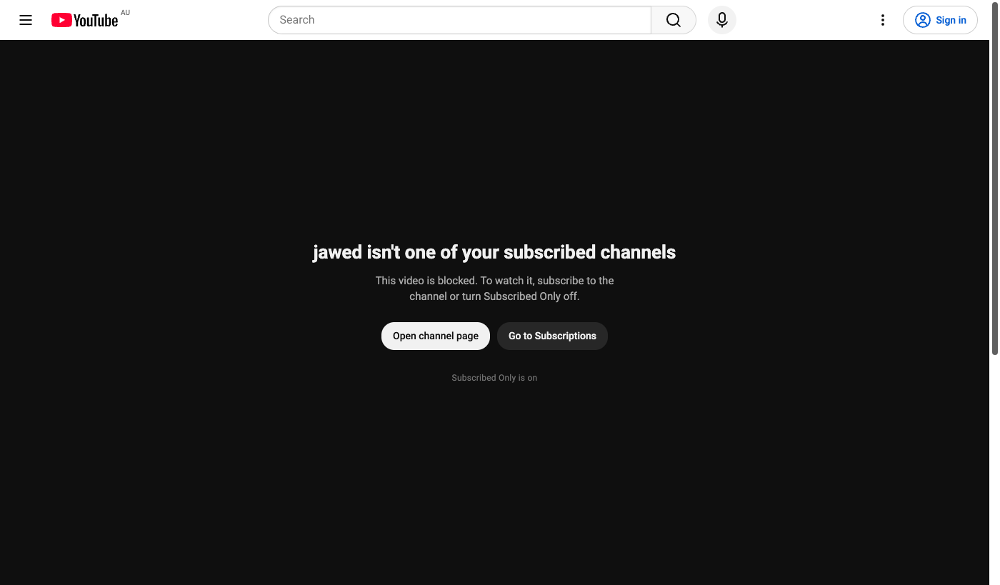

# Subscribed Only

A browser extension for Brave that makes YouTube show and play **only the channels you subscribe to**.

You open YouTube for one video and surface two hours later. This removes the part that does that: everything you didn't choose to follow.



## What it does

When it is switched on:

- **Other channels' videos don't play.** You get the block screen above instead, even from a direct link.
- **They aren't offered to you either.** They are removed from the "up next" sidebar, the end-of-video suggestions and search results.
- **Home, Trending and Explore** take you to your Subscriptions feed.
- **Shorts shelves are gone**, and a Short from another channel is blocked like any other video.
- **YouTube videos embedded on other websites** follow the same rule.

Your Subscriptions feed and the channels you follow work exactly as before.

## Install

It isn't in a web store, so you load it from a folder. It takes about a minute.

1. Download it: on this page click **Code → Download ZIP** and unzip it. (Or `git clone https://github.com/surajx/snx-yt-ch-blkr.git`.)
2. Open `brave://extensions`. In Chrome, use `chrome://extensions`.
3. Turn on **Developer mode** in the top-right corner.
4. Click **Load unpacked** and choose the folder you unzipped (the one that contains `manifest.json`).
5. Open YouTube while signed in. Within a few seconds the extension reads your subscriptions and the tab reloads once.

To check it worked, click the extension's icon in the toolbar. It should say how many channels can play.

Keep the folder where it is: the browser loads the extension from it each time it starts.

## Using it

| You want to | Do this |
|---|---|
| Switch it on or off | Click the toolbar icon and use the switch. The icon shows `OFF` while it is off. |
| Watch a blocked video | Subscribe to its channel on YouTube, or switch the extension off. |
| Allow a channel without subscribing | Toolbar icon → **Manage channels**, then paste the channel's link, `@handle` or ID. |
| Refresh the channel list | It updates when you subscribe or unsubscribe and re-syncs every 12 hours. **Sync now** in the popup forces it. |
| Use it in private windows | Open the extension's details on `brave://extensions` and turn on **Allow in Private**. |

## Good to know

- **Nothing plays until the first sync.** If the icon shows `!`, the channel list is empty: sign in to YouTube and press **Sync now**.
- **Music videos are often on a different channel.** An artist's videos may belong to a "VEVO" or "- Topic" channel, not the one you subscribed to. Add those by hand.
- **Autoplay stops** when the next video is from a channel you don't subscribe to.
- **It is a self-control tool, not a lock.** Anyone using the browser can switch it off.
- **Desktop only.** YouTube Music and the mobile site are not covered.
- **If every video is suddenly blocked**, YouTube has changed something and the extension needs an update. It blocks when unsure on purpose. Please [open an issue](https://github.com/surajx/snx-yt-ch-blkr/issues).

It was built for and tested in Brave. Other Chromium browsers such as Chrome and Edge should work but are untested.

## Privacy

- Everything stays in your browser. There is no server, no account and no analytics.
- It talks only to youtube.com, using the session you are already signed in with, and only to read your list of subscriptions.
- The channel list is kept in the extension's local storage, with a copy in YouTube's site storage in your browser so it is available the instant a page starts loading.
- Permissions requested: `storage`, plus access to `youtube.com` and `youtube-nocookie.com` (the address embedded players use).

## How it works

YouTube loads every page as data and then draws it. The extension steps in between the two:

1. **Gate.** The data that tells the player what to play includes the video's channel ID. If that channel is not on your list, the entry is rewritten as unplayable before the player sees it, so the video never loads.
2. **Feed cleanup.** Lists of videos (sidebar, search, end screen, channel pages) have entries from other channels deleted before YouTube draws them, so there are no gaps or flicker.
3. **Watchdog.** Whatever the player actually has loaded is checked again when it starts playing, in case a video arrived by a route the first two steps don't cover.

Channels are matched by their permanent ID, never by name.

| File | Role |
|---|---|
| `src/inject.js` | Runs inside the page before YouTube's code: gate, feed cleanup, watchdog |
| `src/content.js` | Block screen, redirects, passing settings to the page, keeping the channel list current |
| `src/sync.js` | Reads your subscriptions from YouTube's "All subscriptions" page |
| `src/popup.*`, `src/options.*` | The toolbar popup and the channel list page |
| `src/background.js` | First-run defaults and the toolbar badge |

## Development

There is no build step and there are no dependencies.

```bash
node --test          # unit tests for the filtering logic
node e2e/run.mjs     # end-to-end checks against live YouTube in a throwaway Brave profile
```

The end-to-end suite needs Node 22 or newer and Brave installed. Set `BROWSER_BIN` to use another Chromium browser, `HEADED=1` to watch it run, and `ONLY=blocked,embed` to run a subset. It runs signed out, so it does not cover the subscription sync.

YouTube's page data changes without notice. When something breaks, the end-to-end suite shows which behaviour stopped working, and the fixtures in `test/core.test.js` show the shapes the code expects.

## License

[MIT](LICENSE)

## Disclaimer

This project is not affiliated with, endorsed by, or sponsored by YouTube or Google. YouTube is a trademark of Google LLC.
